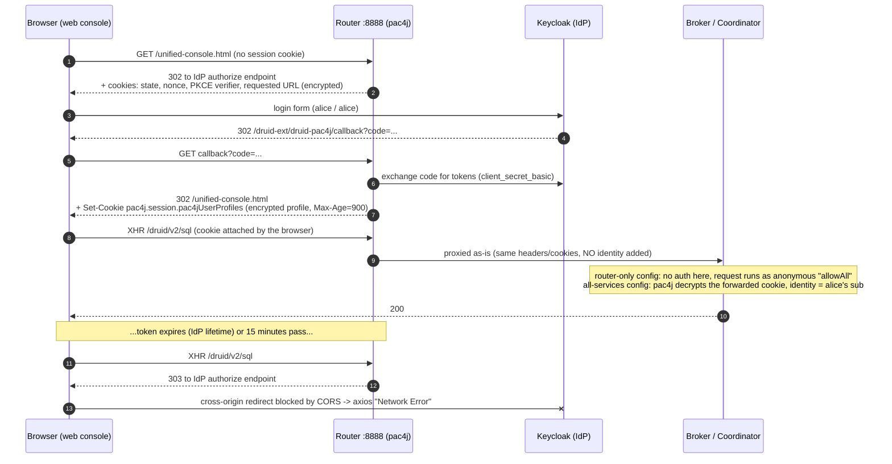
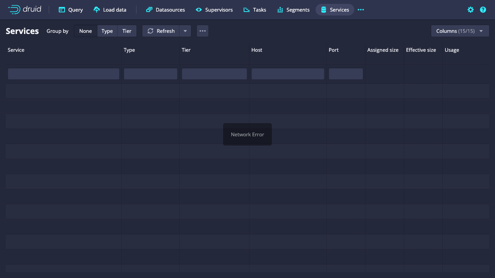

# Druid web console + OIDC (`druid-pac4j`) investigation

How does Apache Druid's OIDC login (the [`druid-pac4j`](https://druid.apache.org/docs/latest/development/extensions-core/druid-pac4j)
extension) actually work with the web console? This repo has a reproducible local setup (Druid + Keycloak with mock users),
the scripts used to probe it, the evidence, and a list of suggested ToDos for the **web console** and the **docs**
(plus some for the extension itself).

The docs currently say:

> The pac4j authenticator should only be used at the router node to enable a group of users in existing authentication
> server to interact with Druid cluster, using the web console.

That raised two questions, which this investigation answers:

1. **The web console has no token-refresh code. How does it keep working?** It doesn't need tokens, and when the session
   ends it simply breaks until the user reloads the page.
2. **What is special about the router? Isn't it just a proxy?** Nothing in the code. It is just the place the browser
   talks to, and it does *not* forward the user's identity to anyone.

Tested on 2026-10-19 with Druid `master` @ `3e9c628f08` (40.0.0-SNAPSHOT), pac4j 5.8.0, Keycloak 26.0.7, and Chromium
driven by Playwright 1.48.2.

## TL;DR

- **The session is one encrypted cookie** (`pac4j.session.pac4jUserProfiles`) holding the user's pac4j profile, encrypted
  with `druid.auth.pac4j.cookiePassphrase`. The console never sees a token. No server keeps session state.
- **Session lifetime = min(IdP token lifetime, 15 minutes)**, counted from login. The 15 minutes is hard-coded
  (`Max-Age=900`). Activity doesn't extend it.
- **After that, every console request breaks with "Network Error".** The API call gets a 302/303 redirect to the IdP, the
  browser blocks it (CORS), and axios reports a network error. Only a **full page reload** recovers. The reload goes
  through the IdP, which still remembers the user, so they come back without typing a password.
- **One-line fix direction for the console:** send `X-Requested-With: XMLHttpRequest`. pac4j then answers expired or
  missing sessions with a clean **`401` + `WWW-Authenticate: Bearer realm="pac4j"`** that the console can detect and
  turn into a "session expired, sign in again" experience. Verified in a real browser.
- **"Router only" (docs taken literally) leaves the broker, coordinator, etc. completely unauthenticated**, and the broker
  sees every console user as the same anonymous user. Per-user permissions are impossible in that setup.
- **pac4j on every service works.** The router forwards the browser's cookie, and the broker or coordinator decrypts it
  with the shared passphrase and gets the real user. Internal traffic needs `basic` (or similar) in front of `pac4j` in
  the authenticator chain.
- Several doc gaps (callback URL, `authorizerName`, `clientAuthenticationMethod`, `oidcClaim`, session lifetime,
  HTTPS) and a few extension issues (lost profile context, ~40 ms per request, no logout). See [ToDos](#todos).

## How it works



Relevant code:

- [`Pac4jFilter`](https://github.com/apache/druid/blob/master/extensions-core/druid-pac4j/src/main/java/org/apache/druid/security/pac4j/Pac4jFilter.java):
  handles the callback path and runs pac4j's `DefaultSecurityLogic` on every other request.
- [`Pac4jSessionStore`](https://github.com/apache/druid/blob/master/extensions-core/druid-pac4j/src/main/java/org/apache/druid/security/pac4j/Pac4jSessionStore.java):
  stores every pac4j session value as its own encrypted cookie (`Max-Age=900`, always `Secure`, `HttpOnly`). Adapted
  from Apache Knox.
- [`Pac4jAuthenticator`](https://github.com/apache/druid/blob/master/extensions-core/druid-pac4j/src/main/java/org/apache/druid/security/pac4j/Pac4jAuthenticator.java):
  `setExpireSessionWithToken(true)`, `setUseNonce(true)`. It does **not** override `Authenticator.decorateProxyRequest`;
  only Kerberos does.
- [`AsyncQueryForwardingServlet`](https://github.com/apache/druid/blob/master/services/src/main/java/org/apache/druid/server/AsyncQueryForwardingServlet.java):
  the router's proxy. It uses a plain (non-escalated) Jetty client and only calls `decorateProxyRequest`, so for pac4j
  the downstream service gets exactly the browser's headers and cookies.

## Findings

### 1. The console has no session handling, so expiry shows up as "Network Error"

Real Chromium, logged in as `alice`, idle for 150 s (realm token lifetime is 120 s), then the console's normal requests
([full log](evidence/browser-expiry-run.log)):

```
fresh session: XHR (what the console does)   -> status 200
after expiry:  XHR (what the console does)   -> onerror (status 0) -> axios would report "Network Error"
after expiry:  XHR + X-Requested-With header -> status 401 www-authenticate=Bearer realm="pac4j" body=<html>...
browser console: Access to XMLHttpRequest at 'http://localhost:18080/realms/druid/protocol/openid-connect/auth?scope=openid+profile+email&response_type=code&redirect_uri=http%3A%2F%2Flocalhost%3A8888%2Fdruid-ext%2Fdru...
request failed:  GET http://localhost:18080/realms/druid/protocol/openid-connect/auth?... net::ERR_FAILED
full page reload -> login form shown? false   (silently re-authenticated through the IdP's own session)
after reload:  XHR (what the console does)   -> status 200
```

What the user sees after expiry (the Services view), with nothing telling them to reload:



Notes:

- pac4j decides "is this AJAX?" with its default `AjaxRequestResolver`, i.e. the `X-Requested-With: XMLHttpRequest`
  header. axios doesn't send it, so the console gets the browser-style redirect.
- Verified with curl that with the header, **both GET and POST** get `401` + `WWW-Authenticate: Bearer realm="pac4j"`,
  and that the header doesn't affect `basic` auth (`curl -u admin:admin -H 'X-Requested-With: XMLHttpRequest'` → 200).
- Every console request goes through the single axios instance created in
  [`web-console/src/entry.tsx`](https://github.com/apache/druid/blob/master/web-console/src/entry.tsx) (no raw
  `fetch`/`EventSource`), so one header covers everything.
- **Workaround that exists today, no code change:** `customHeaders` in `console-config.js` can add
  `{"X-Requested-With": "XMLHttpRequest"}`. But the 401 body is Jetty's HTML error page, and the console's axios
  interceptor uses a string response body as the error message for GETs, so users would see raw HTML instead of
  "Network Error". Better, still not good.
- What survives a reload: workbench tabs (query text) are in `localStorage`. Results, running-query tracking and open
  dialogs are lost.

### 2. Session lifetime: min(IdP token lifetime, 15 minutes), not sliding

- `pac4j.session.pac4jUserProfiles` is set once, at the callback, with `Max-Age=900`. Authenticated requests do **not**
  re-issue it (checked: each request only re-sets the CSRF cookies: three encrypted `pac4j.session.*Csrf*` ones plus a
  plain `pac4jCsrfToken`).
- `setExpireSessionWithToken(true)` is enforced. Login at 23:27:16Z with a 120 s token lifetime: a request at 23:29:42Z
  with the same cookie got `302` to the IdP.
- So with Keycloak's default 5-minute token lifetime, console users get kicked out every 5 minutes. With a 1-hour token
  lifetime (common for Okta etc.), it's every 15 minutes.
- Because the IdP keeps its own longer session (Keycloak `KEYCLOAK_IDENTITY` cookie), a top-level navigation to Druid
  re-authenticates without a password prompt. That is why "just reload" works and why the console can get away with
  having no refresh-token logic.

### 3. "Only at the router": what it actually means

Two configs were tested (see [`druid/`](druid)):

| | `oidc-router-only` (docs taken literally) | `oidc-all` (`["basic", "pac4j"]` on every service) |
|---|---|---|
| Console via router | works | works |
| `curl :8082/druid/v2/sql` (broker, no credentials) | **200, query runs** | 303 to IdP |
| `curl :8081/...` (coordinator, no credentials) | **200** | 302 to IdP |
| Identity the broker sees for a console query | `allowAll` (anonymous) | `0b46f85b-...` (alice's `sub`) |
| Internal service-to-service traffic | unauthenticated | `basic` escalator (`druid_system`) |

Broker request log (`druid.request.logging.type=slf4j`) for a console query in the `oidc-all` setup:

```
LoggingRequestLogger - ... {"query/time":11,"success":true,"statusCode":200,"identity":"0b46f85b-79d3-49d6-a684-fd0fb05b48b7"} {"queryType":"scan","dataSource":{"type":"inline","columnNames":["marker"],...,"rows":[["via-router"]]}...
```

So the router isn't special in the code. It's just the service browsers should reach, because the console is served
from there and it's the address you register as the redirect URI. A better wording of the docs: "Users should reach
the web console through the router. To authorize per user, every service that receives proxied console requests must
also run pac4j with the same `cookiePassphrase`, behind an authenticator for internal traffic."

### 4. The session cookie is a portable bearer token

- Taking the cookies from the router login and sending them **directly to the broker** (`:8082`) → `200`. Sending
  **only** `pac4j.session.pac4jUserProfiles` to the coordinator (`:8081`) → `200`. Any service with the same passphrase
  accepts it until it expires. `JSESSIONID` isn't needed.
- Consequences: no server-side revocation and no logout (the extension has no logout endpoint). The
  `cookiePassphrase` is effectively the signing key for every session. The docs' warning about a strong passphrase
  (CVE-2024-45384) is the right instinct, but the docs don't explain *why* it matters this much.

### 5. Following the docs against Keycloak fails out of the box

With only the documented required properties, the first login fails with:

```
HTTP ERROR 500 org.pac4j.core.exception.TechnicalException: privateKeyJwtConfig cannot be null
```

Keycloak's discovery document lists `token_endpoint_auth_methods_supported` as `["private_key_jwt",
"client_secret_basic", "client_secret_post", ...]`, and pac4j auto-selects the first. The fix is the (documented)
`druid.auth.pac4j.oidc.clientAuthenticationMethod=client_secret_basic`, but nothing tells you that you'll need it.

### 6. The Druid identity is always `sub`; `oidcClaim` doesn't apply

`Pac4jFilter` uses `profile.getId()` (the `sub` claim, a UUID in Keycloak) as the identity. `druid.auth.pac4j.oidc.oidcClaim`
is only read by `JwtAuthFilter` (the `jwt` authenticator). The docs present `oidcClaim` as a general setting, so
authorizer rules written for `alice` won't match a pac4j web login.

### 7. Regression: user profile no longer passed to authorizers

[#16109](https://github.com/apache/druid/pull/16109) put the pac4j `UserProfile` into `AuthenticationResult.context`
(`{"profile": ...}`) so authorizers like OPA could use claims. The pac4j upgrade in
[#18259](https://github.com/apache/druid/pull/18259) rewrote `Pac4jFilter` and now passes `null`
(`git log -S'ImmutableMap.of("profile"' -- extensions-core/druid-pac4j` shows both commits).

### 8. About 40 ms of extra latency per request

Every authenticated request decrypts the session cookies and re-issues three encrypted CSRF cookies, and each encrypt/decrypt in Druid's `CryptoService`
derives a fresh key with PBKDF2 (65536 iterations, random salt per encryption):

```
coordinator direct             ~0.003 s
same call via router + pac4j   ~0.043 s
```

The console makes many parallel requests (e.g. the Services/Segments views), so this adds up. The CSRF tokens
aren't even checked: `Pac4jFilter` passes authorizers `"none"` ("to avoid CSRF issues").

### 9. Cookies are always `Secure`

`Pac4jSessionStore` always sets `Secure` (and logs a warning on plain HTTP). Chromium accepts `Secure` cookies on
`http://localhost`, which is how this setup works. On any other plain-HTTP host, browsers drop them per the cookie
spec, so login would loop (expected from the spec, not tested here). The docs should say HTTPS is required (except
localhost).

### 10. Smaller code observations

- `Pac4jFilter` reads `pac4j.originalUrl` from the `HttpSession` for the post-login redirect, but nothing ever sets it.
  The redirect actually works through pac4j's own `pac4jRequestedUrl` cookie.
- `Pac4jSessionStore.set` also writes every value into the Jetty `HttpSession` (hence `JSESSIONID`), even though reads
  only use cookies.
- There are no integration tests for pac4j at all (only unit tests with mocks).

## ToDos

### Web console

- [ ] Send `X-Requested-With: XMLHttpRequest` on all API requests (`Api.getDefaultConfig()`), so an expired session
      becomes a detectable `401` instead of an opaque "Network Error". Verified with pac4j. It should be harmless for
      other authenticators, but double-check `basic` (a `WWW-Authenticate: Basic` 401 on XHR can trigger the browser's
      native prompt; that is existing behavior).
- [ ] Add a global axios response interceptor: on `401` (especially with `WWW-Authenticate: Bearer realm="pac4j"`),
      show a single "Your session has expired" dialog with a **Sign in again** button, instead of per-view errors with
      HTML bodies. Deduplicate the many parallel failures into one dialog.
- [ ] Decide how "Sign in again" works:
  - simplest: `window.location.reload()` (loses in-memory state: results, running-query tracking, open dialogs);
  - nicer: open the console URL in a **popup**, which goes through the IdP and sets fresh cookies shared with the
    original tab. When it lands back on the console, close it and retry the failed requests. Nothing lost. (A hidden
    iframe is less likely to work: IdPs usually forbid framing.)
- [ ] Until the above exists, make the generic "Network Error" message more helpful for same-origin requests, e.g.
      "...this can happen when your login session expires; try reloading the page."
- [ ] Before reloading, warn if queries are running or there is unsaved state (ingestion spec being edited, etc.), and
      make sure everything worth keeping is in `localStorage`.
- [ ] Show the signed-in user and offer **Log out** (needs backend support, see below).

### Documentation (`docs/development/extensions-core/druid-pac4j.md`)

- [ ] Rewrite the "only be used at the router node" sentence (and add the missing "the"). Explain that browsers should
      use the router, and that services behind it need pac4j too (same passphrase), with another authenticator such as
      `basic` first in the chain for internal traffic, or else they're unauthenticated and see no user identity.
- [ ] Add a complete, working example: router + common config, authenticator chain, escalator, authorizer
      (see [`druid/all-services.properties`](druid/all-services.properties)).
- [ ] Document the **redirect/callback URI** to register with the IdP: `https://<router>/druid-ext/druid-pac4j/callback`.
      The page never mentions it.
- [ ] Document `druid.auth.authenticator.<name>.authorizerName` (needed, missing from the table).
- [ ] Fix the "Creating an Authenticator" snippet: it sets `druid.auth.authenticatorChain` twice (`["pac4j"]` then
      `["jwt"]`), so a copy-paste keeps only `jwt`. Show them as alternatives or as one chain.
- [ ] Say that `oidcClaim` applies only to the `jwt` authenticator; for pac4j the identity is `sub`.
- [ ] Recommend setting `clientAuthenticationMethod` explicitly, and mention the Keycloak `privateKeyJwtConfig cannot be null` error.
- [ ] Document session behavior: lifetime = min(IdP token lifetime, 15 min), not extended by activity, no logout,
      re-login is silent while the IdP session lasts.
- [ ] Document that HTTPS is required (cookies are always `Secure`), localhost excepted.
- [ ] Explain what the `cookiePassphrase` protects (it decrypts *and creates* sessions on every service), and recommend a
      [password provider](https://druid.apache.org/docs/latest/operations/password-provider).
- [ ] Consider adding a short "Using OIDC with the web console" section to `operations/web-console.md` linking here.

### `druid-pac4j` extension (for discussion with maintainers)

- [ ] Restore `AuthenticationResult` context with the user profile (regression from #18259).
- [ ] Let the identity come from a configurable claim (reuse `oidcClaim` or add a new property) instead of always `sub`.
- [ ] Make the session cookie max age configurable (and consider re-issuing it on activity).
- [ ] Remove the per-request cost: stop generating CSRF cookies nobody checks and/or cache derived keys in `CryptoService` usage.
- [ ] Add a logout endpoint (clear cookies, optionally RP-initiated logout at the IdP) and a "who am I" endpoint for the
      console.
- [ ] Remove the dead `pac4j.originalUrl` lookup and the unneeded `HttpSession` writes.
- [ ] Add an integration test with a real IdP (Keycloak in Docker, like this repo).

## Reproduce it

### Prerequisites

- Docker
- A built Druid distribution, e.g. from a Druid checkout: `mvn clean install -Pdist -T1C -DskipTests`, which produces
  `distribution/target/apache-druid-<version>`
- Python 3 (for the scripted flow) and Node.js (for the browser test)

### 1. Start the mock OIDC provider

```bash
docker compose up -d     # Keycloak on http://localhost:18080, realm "druid" imported from keycloak/
```

The `druid` realm ([`keycloak/druid-realm.json`](keycloak/druid-realm.json)) contains:

| What | Value |
|---|---|
| OIDC client | `druid` / secret `druid-client-secret`, redirect URIs `http://localhost:8888/*` |
| User | `alice` / `alice` (Alice Admin, alice@example.com) |
| User | `bob` / `bob` (Bob Reader, bob@example.com) |
| Token lifetime | **120 s** (deliberately short so expiry is easy to observe; Keycloak's default is 300 s) |
| Keycloak admin console | http://localhost:18080/admin, `admin` / `admin` (master realm) |

The users have no roles; with the `allowAll` authorizer the names are just labels.

### 2. Configure and start Druid

```bash
./druid/setup-conf.sh /path/to/apache-druid-<version>   # creates conf/druid/oidc-router-only and conf/druid/oidc-all
cd /path/to/apache-druid-<version>
bin/start-druid -m 6g -c conf/druid/oidc-all            # or conf/druid/oidc-router-only
```

The `oidc-all` config also creates Druid basic-auth users `admin` / `admin` and `druid_system` / `internal` (internal
traffic). These bypass OIDC, e.g. `curl -u admin:admin http://localhost:8082/...`.

### 3. Try it

- Browser: open http://localhost:8888 in **Chrome** and log in as `alice` / `alice`. Wait 2+ minutes, click around,
  and watch "Network Error"; reload and you're back in without a password.
- Scripted login, printing every redirect and cookie
  ([sample output](evidence/oidc-flow-run.log)):

  ```bash
  python3 scripts/oidc_flow.py alice alice /status "POST /druid/v2/sql {\"query\":\"SELECT 1\"}"
  python3 scripts/oidc_flow.py --reuse /status    # reuse the saved cookies later, e.g. after expiry
  ```

- Real-browser expiry test (about 3 minutes; writes screenshots to `evidence/`):

  ```bash
  cd scripts && npm install && npx playwright install chromium && node browser_expiry.js
  ```

- Probes used for the router question:

  ```bash
  curl -s -o /dev/null -w '%{http_code}\n' http://localhost:8888/druid/coordinator/v1/leader                                # 302 (to IdP)
  curl -s -o /dev/null -w '%{http_code}\n' -H 'X-Requested-With: XMLHttpRequest' http://localhost:8888/druid/coordinator/v1/leader  # 401
  curl -s -H 'Content-Type: application/json' -d '{"query":"SELECT 1"}' http://localhost:8082/druid/v2/sql                  # open in router-only, 303 in all
  ```

### Cleanup

```bash
docker compose down
# stop Druid with Ctrl-C in the start-druid terminal
```

## Repo layout

```
docker-compose.yml           Keycloak (mock IdP)
keycloak/druid-realm.json    realm: client "druid", users alice and bob
druid/setup-conf.sh          builds the two Druid configs from a distribution's conf/druid/auto
druid/router-only.properties config overlay: pac4j on the router only (docs as written)
druid/all-services.properties config overlay: basic + pac4j on every service
scripts/oidc_flow.py         stdlib-only scripted login that prints every hop
scripts/browser_expiry.js    Playwright test: login, expiry, X-Requested-With probe, reload
evidence/                    logs and screenshots from the runs described above
```
